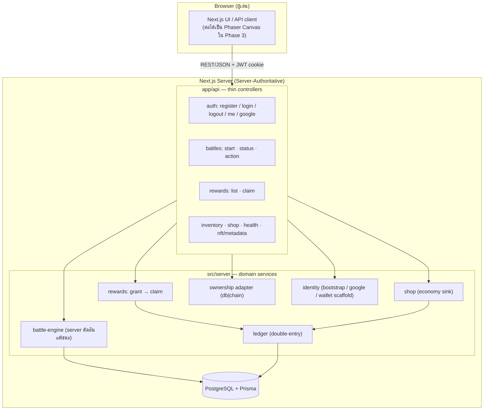
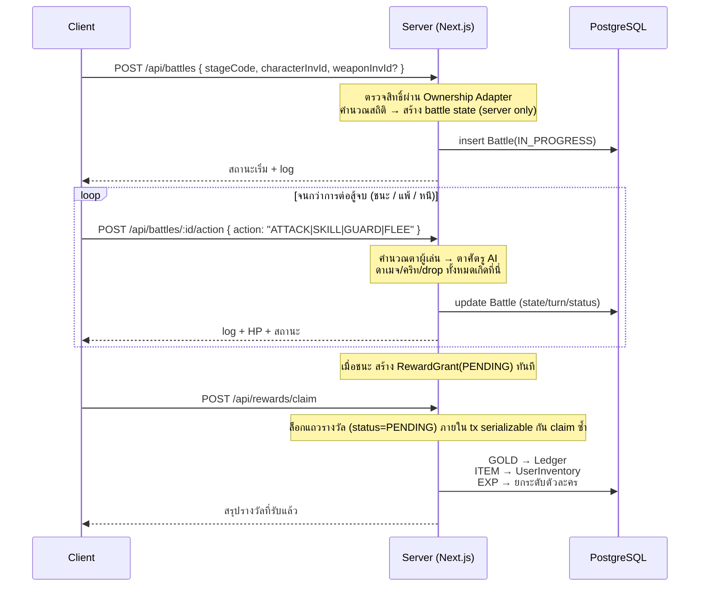
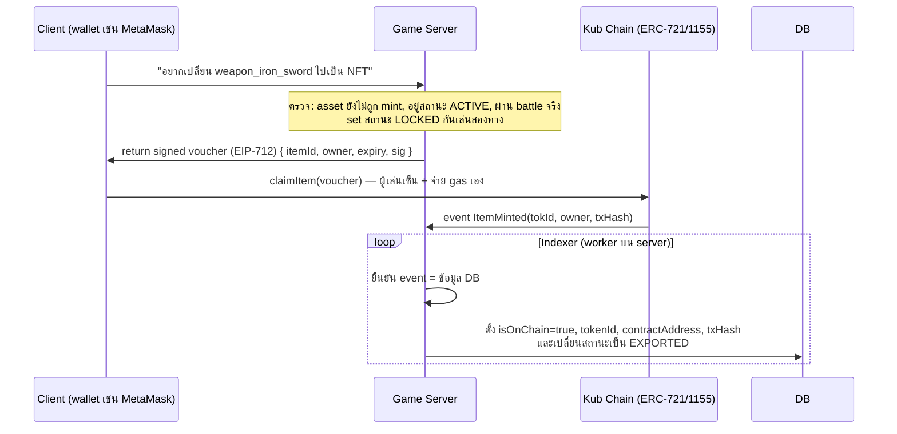

# 01 — System Architecture

> สรุปโปรเจกต์: เกม **2D Turn-based RPG บนเบราว์เซอร์** ที่สร้างเป็น Web2 ก่อน
> และออกแบบให้พร้อมต่อ **Kub Chain (EVM)** ในอนาคต
> Stack: **Next.js (App Router, TypeScript) + Prisma + PostgreSQL**

## 1. หลักการออกแบบ (ตามโจทย์)

| เป้าหมาย | วิธีที่ใช้ใน repo |
|---|---|
| แยก Game Logic ออกจาก Identity/Asset | เลเยอร์เกม (`src/server/game/*`) ไม่รู้จักการเชื่อม blockchain เลย ตรวจสิทธิ์ทรัพย์สินผ่าน **Ownership Adapter** เพียงช่องเดียว |
| พร้อม Tokenomics / NFT | เหรียญในเกมเดินผ่าน **Ledger แบบ double-entry** สามารถแม็ปเป็น ERC-20 ได้ และ item/character มีฟิลด์ Web3 ครบ (`tokenId`, `contractAddress`, `transactionHash`, `isOnChain`) |
| Hybrid Authentication | `User` + `AuthIdentity` รองรับ `EMAIL_PASSWORD`, `GOOGLE_OAUTH`, `WALLET_SIGN_IN` (wallet login เปิดใช้ใน Phase B) |
| Anti-Cheat / Server-Authoritative | ฝั่ง client ส่งได้เพียง "action" ผลทั้งหมดคำนวณที่ server และเก็บ snapshot ใน `Battle.state` |

## 2. ผังระบบ (สถานะปัจจุบัน = Phase A)

- Client ไม่มีอำนาจการตัดสินใดเลย: HP, ผลชนะ, รางวัล อ่านกลับจาก server เสมอ
- ผู้เล่นพยายามแก้ค่า JavaScript หรือ packet ก็ไม่กระทบผล เพราะตัวเลขทั้งหมดเกิดที่ server

## 3. Flow สำคัญ 1: รอบการเล่น + การรับรางวัล

## 4. Flow สำคัญ 2: Web3 Bridge (เวลาถึง Phase C)

หลักการ: server เป็นผู้อนุมัติ (ผ่านลายเซ็น EIP-712) — ผู้เล่นเรียก claim mint ด้วยกระเป๋าของตัวเอง แล้ว indexer ยืนยันสถานะกลับเข้า DB

โค้ด scaffold ที่ชี้ทางอันนี้มีอยู่แล้ว:
- `src/server/ownership/chain-provider.ts` — อ่านสิทธิ์ `ownerOf()` ผ่าน JSON-RPC (เปิดเมื่อ `WEB3_BRIDGE_ENABLED=true` + ระบุ contract address)
- `prisma/schema.prisma` — ฟิลด์ Web3 ครบในตาราง `UserInventory` และ `ItemTemplate`
- `src/app/api/nft/metadata/[inventoryId]/route.ts` — JSON ตามมาตรฐาน ERC-721 (ใช้ upload ขึ้น IPFS ภายหลัง)

## 5. ระบบสกุลเงิน: Ledger ↔ Token

| LedgerAccount | ความหมาย | แม็ปเมื่อถึง Phase C |
|---|---|---|
| `player:<userId>` | เหรียญในเกมของผู้เล่น | ยอด token ที่เข้า wallet จริง |
| `system:treasury` | คลังกลางของระบบ (จ่ายรางวัล) | wallet ของ server game |
| `system:shop` | เหรียญที่ออกจากเกมหลังซื้อของ (sink) | burn ที่เกิดจริงปลายทาง |
| `mint` | แหล่งกำเนิดเหรียญ | `GameToken.mint()` โดย server |
| `burn` | ที่ทำไปแล้ว | `GameToken.burn()` |

กติกาบัญชี: `sum(DEBIT) = sum(CREDIT)` ทุก entry — เครื่องรับรองด้วย `postEntry()` และตรวจทุกครั้งได้ด้วย `npm run audit:ledger`

## 6. ข้อมูลอ้างอิง Kub Chain ในโปรเจกต์

| สาย | Chain ID | RPC | Explorer | Symbol |
|---|---|---|---|---|
| KUB Mainnet | `96` | `https://rpc.kubchain.io` | `https://kubscan.com` | KUB |
| KUB Testnet | `25925` | `https://rpc-testnet.kubchain.io` | `https://testnet.kubscan.com` | tKUB (มี faucet) |
| KUB L2 Mainnet | `9601` | `https://kublayer2.kubchain.io` | `https://kublayer2.kubscan.com` | KUB |
| KUB L2 Testnet | `259251` | `https://kublayer2.testnet.kubchain.io` | `https://kublayer2.testnet.kubscan.com` | tKUB |

ตั้งค่าชุดนี้ที่ไฟล์ `.env` (KUB_CHAIN_ID, KUB_CHAIN_RPC_URL, KUB_CHAIN_EXPLORER_URL) — โมดูลทุกชิ้นอ่านผ่าน src/lib/env.ts จุดเดียว

ต่อ: [02-database-schema.md](./02-database-schema.md) · [03-roadmap.md](./03-roadmap.md)