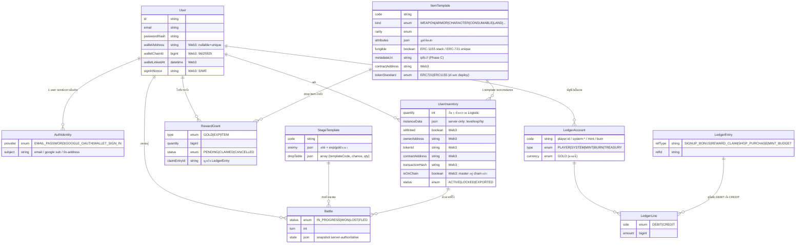

# 02 — Database Schema (Web3-ready)

> ไฟล์: `prisma/schema.prisma`
> หลักการ: **ตารางทุกจุดคิดไปถึงวันที่จะเชื่อม NFT/Token แล้ว** — ไม่ต้อง migration โครงสร้างตอนนั้น

## 1. ERD



## 2. ฟิลด์ Web3-ready ที่ "ถูกเสียบมาตั้งแต่วันแรก"

| ตาราง | ฟิลด์ | ไว้ทำอะไร |
|---|---|---|
| `User` | `walletAddress` (nullable, unique), `walletChainId`, `walletLinkedAt`, `signInNonce` | Phase B: Connect Wallet + SIWE โดยไม่แปลงสถานะอื่น |
| `ItemTemplate` | `metadataUri`, `metadataHash`, `contractAddress`, `tokenStandard` | ผูกแหล่ง metadata (IPFS) + collection contract |
| `UserInventory` | `isMinted`, `ownerAddress`, `tokenId`, `contractAddress`, `tokenStandard`, `transactionHash`, `blockNumber`, `isOnChain`, `mintedAt`, `exportedAt`, `status` | พร้อม mint/export; `status LOCKED/EXPORTED` กัน double-spend ตอนขึ้น chain |

## 3. แบบ Ledger แบบ Double-entry

- `balance = SUM(DEBIT) − SUM(CREDIT)` สำหรับทุกบัญชี
- ทุก `LedgerEntry` มี lines คู่ฝั่ง DEBIT/CREDIT รวมเท่ากันอย่างเป็นบริทค (enforce ใน `postEntry`)
- การปิดจบนอทุ่งในเกมต้องยังมีสร้างหนุน pricing

ตัวอย่าง entry ตามจริงที่ระบบสร้าง:

```
1) MINT_BUDGET (รันครั้งแรก)
   DEBIT system:treasury        10,000,000 GOLD
   CREDIT mint                  10,000,000 GOLD

2) SIGNUP_BONUS (สมัครใหม่)
   DEBIT player:<userId>              500 GOLD
   CREDIT system:treasury             500 GOLD

3) REWARD_CLAIM (ชนะด่าน, refId = RewardGrant id)
   DEBIT player:<userId>              38 GOLD
   CREDIT system:treasury             38 GOLD

4) SHOP_PURCHASE (ซื้อ Small Potion)
   DEBIT system:shop                  45 GOLD
   CREDIT player:<userId>             45 GOLD
```

ตรวจสอบได้ทันที: `npm run audit:ledger` (ออกรายงานเงินติดลบแปลกทั้งสโนเวยนและ exit code ให้ CI)

## 4. เส้นทาง NFT Metadata (มาตรฐาน ERC-721)

สร้างแล้วที่ `src/server/nft/metadata.ts` และ expose ผ่าน `/api/nft/metadata/:inventoryId`:

```json
{
  "name": "Recruit #a1s2d3",
  "description": "ทหารหนุ่มผู้ออกรบเพื่อปกป้องหมู่บ้านเล็กริมป่า (ตัวละครเริ่มต้น)",
  "image": "ipfs://<CID>/recruit.png",
  "attributes": [
    { "trait_type": "Kind",      "value": "CHARACTER" },
    { "trait_type": "Rarity",    "value": "COMMON" },
    { "trait_type": "Level",     "value": 1 },
    { "trait_type": "HP",        "value": 130 },
    { "trait_type": "ATK",       "value": 14 },
    { "trait_type": "DEF",       "value": 8 },
    { "trait_type": "SPD",       "value": 9 },
    { "trait_type": "Crit",      "value": 0.08 }
  ],
  "game": { "inventoryId": "<cuid>", "level": 1, "earnedAt": "2026-01-01T00:00:00.000Z" },
  "onchain": {
    "contractAddress": "0x... (Phase C)",
    "tokenId": "42",
    "standard": "ERC721",
    "chainId": "25925",
    "chainName": "Kub Chain",
    "explorerUrl": "https://testnet.kubscan.com/token/0x..."
  }
}
```

`onchain` จะปรากฏเฉพาะเมื่อ `isOnChain=true` จริง (หลัง mint ใน Phase C)

## 5. ข้อตกลงชื่อ/หน่วย

- เก็บ wallet address เป็น **lowercase** ตลอดเพื่อก้อนข้อความค่าชนกันใน DB
- `BigInt` ใช้กับเงินทุกครั้ง (GOLD) — ส่งผ่าน API เป็น string
- `code` ของ template/stage เป็น snake_case และใช้ใน seed/drop table สอดคล้อเชื่อในอนาคต
